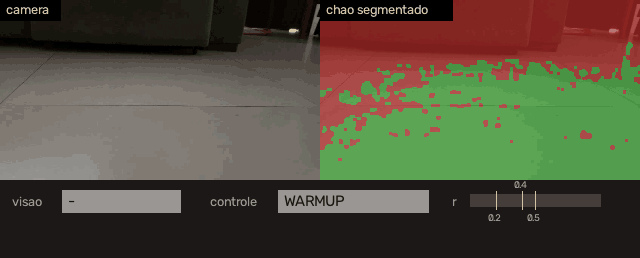
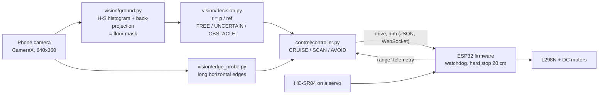

# Self-driving car with classical computer vision

**A small autonomous car whose brain is Python running on a phone, and whose body is an ESP32.** The phone's camera is the only perception: the floor is segmented with color histograms (no neural network or GPU), a state machine decides, and an ESP32 drives the motors and enforces the safety limits. A frame costs ~18 ms on a Samsung S9.


-e7352c)

<p align="center">
  
</p>
<p align="center"><sub>Replay of a recorded run (10 s, the car heading to a sofa). Left: camera. Right: floor segmentation (green = floor). Bottom: vision state, controller state and the confidence <code>r</code> with its thresholds. The range sensor is mocked and the replay is open loop.</sub></p>

> 🇧🇷 Versão em português: [README.pt-BR.md](README.pt-BR.md)
>
> **Jump to:** [Engineering decisions](docs/engineering-decisions.md) · [Architecture](docs/architecture.md) · [Results](#results) · [Run it](#running-it) · [Repository layout](#repository-layout)

## Overview

The goal was to see how far a **classical, explainable** vision pipeline can go on a low-end platform before reaching for a learned model. The car has no map and no training data: it learns what "floor" looks like from the first frames of each run, estimates how much free floor lies ahead, and turns that into a drive command.

The work is split across three layers that communicate through narrow, tested interfaces:

| Layer | Runs on | Responsibility |
|---|---|---|
| **Vision + decision** | Python (PC or phone via Chaquopy) | floor segmentation, free-space estimate, obstacle state machine, controller |
| **Link** | Wi-Fi (ESP32 soft AP, WebSocket, one JSON message per frame) | commands down, telemetry and logs up |
| **Body** | ESP32 firmware | motors (L298N), ultrasonic sensor on a servo, watchdog, hard stop |

What I would point to in this project:

- **Vision without training.** Hue-saturation histogram of the floor, back-projection, an automatic threshold from a percentile of the region of interest, and morphology. No dataset, no labels, nothing to retrain when the floor changes.
- **A decision that does not depend on the frame rate.** The obstacle state is driven by a confidence *relative* to a rolling reference, with hysteresis and persistence expressed in seconds. The same behavior holds at 5, 10 or 20 fps (covered by tests).
- **Safety in layers.** Vision proposes, the range sensor has the final say, and the firmware enforces a hard stop at 20 cm, a 500 ms command watchdog and an arming button, independent of the Python side.
- **One codebase, two targets.** The same Python runs on a PC and on the phone. A hardware abstraction layer with mocks lets the whole control loop be replayed from recorded video, so decisions can be validated without the car.
- **Measured, not assumed.** ~9 ms per frame on a PC and ~18 ms on the S9 (a 30 fps source is processed in real time). On the PC one OpenCV thread beat twelve; on the phone 1 to 4 threads cost the same, so it runs with one.
- **Each sensor covers the other's blind spot.** Color vision cannot see a wall painted like the floor; the ultrasonic sensor can. The controller is built around that division of labor.

## Status

**v1 complete.** The vision pipeline, controller, firmware and Android app work end to end. Behavior was validated by replaying recorded runs in three scenarios (a sofa with a nearby object, a narrow corridor, and an open space leading to a wall whose color is close to the floor's), by bench tests of the firmware, and by closed-loop runs on the assembled car, with the phone's vision and the ultrasonic sensor driving the ESP32.

Vision alone does not solve the wall of similar color; the range sensor does, and that division of labor is the point of the design. One drive motor was defective when the kit arrived, which limits how well the car executes what is commanded (see [Limitations](#limitations)).

## Architecture



Per frame: segment the floor, turn the free-space estimate into one of three vision states, fuse it with the edge probe and the range sensor in a small state machine, and send a drive command. The ESP32 keeps its own reflexes (hard stop, watchdog, arming) whatever the phone does, and also serves a web page to operate and watch the car. Details, wiring and the operator page: [docs/architecture.md](docs/architecture.md).

## Engineering decisions

Nine decisions, each with the problem, the alternative discarded and the evidence in the repository: floor model learned from the run, threshold derived from data, relative confidence with an "uncertain" state, time in seconds instead of frames, an independent edge cue, sensor-over-vision fusion with firmware reflexes, hardware behind mocks, measured performance, and experiments kept out of the loop. Read them in [docs/engineering-decisions.md](docs/engineering-decisions.md).

## Results

**Replay of recorded runs** (`python -m replay.replay_main`; range sensor mocked from a hand-written timeline, 10 fps). Logs are in [`assets/.../docs/logs/run/`](assets/simulation_Scar/Reframed_videos/docs/logs/run).

| Scenario | Frames | Vision states (free / uncertain / obstacle) | Controller (cruise / scan / avoid) | What happened |
|---|---|---|---|---|
| Narrow corridor | 125 | 72 / 53 / 0 | 63 / 62 / 0 | no false obstacle; the car keeps cruising and scanning |
| Open space, wall of similar color | 189 | 99 / 48 / 42 | 43 / 58 / 88 | edge probe flags the wall at 4.1 s, the sensor trips at 4.5 s (avoidance starts), vision confirms at 4.7 s |
| Sofa with a nearby object | 105 | 30 / 12 / 63 | 27 / 18 / 60 | vision alone calls the obstacle at 2.1 s and triggers avoidance, with no sensor reading to refute it |

**Cost per frame** (`tools/bench_s9.py`, 848x478 source, 105 to 106 frames, edge probe on):

| Platform (source fps) | Decode | Segmentation | Edge probe | Decision + controller | Total |
|---|---|---|---|---|---|
| PC, 1 OpenCV thread (10) | 0.4 ms | 5.2 ms | 3.3 ms | < 0.05 ms | 8.5 ms |
| PC, 12 threads (10) | 0.4 ms | 5.7 ms | 3.9 ms | < 0.05 ms | 9.6 ms |
| Samsung S9, 1 thread (30) | 2.4 ms | 9.9 ms | 7.6 ms | 0.1 ms | 17.6 ms |

On the S9 the pipeline computes at ~56 fps, so it keeps up with a 30 fps source (33 ms budget) and has about 5.7x headroom at the 10 fps the car runs at. The full series on the phone (19 runs, 1 to 4 threads) is in [`bench_s9_runs.txt`](assets/simulation_Scar/Reframed_videos/docs/logs/bench/bench_s9_runs.txt); totals stay between 17.5 and 18.1 ms.

**Tests:** 24 automated tests (`pytest tests`) cover the controller state machine, the decision thresholds at several frame rates, the run loop, the Android frame-conversion path and an end-to-end synthetic pipeline.

## Limitations

- **Motion fidelity is limited by the hardware.** One drive motor had a gearbox defect from the start. The two sides diverge, the faster one draws more current and accelerates further, so even a straight command drifts into a curve. A software correction of the motor force did not hold. Closed-loop runs were qualitative; the quantitative results here come from replays and benchmarks, and the motor-force constants are the only values calibrated on the car.
- **Vision alone does not solve a wall whose color is close to the floor's.** The color model under-reacts, the edge probe needs a visible baseboard, and optical flow did not help. The range sensor covers this case, which is why the controller treats it as the authority. A learned monocular depth model is the candidate next step.
- **Replays use a scripted sensor.** The timelines were written by hand from the videos, so they show that the logic behaves sensibly, not detection accuracy. There is no labeled benchmark.
- **Other parameters are demo or hypothesis values** (speeds, turn rate, several thresholds); see [`docs/parametros_a_calibrar.md`](docs/parametros_a_calibrar.md).
- **The floor model assumes free floor at the start** (it learns from the first 0.9 s) and the camera is monocular, so distance comes only from the ultrasonic sensor.
- **Narrow validation set and legacy simulator.** Three recordings in one home, of which only the sofa video is in the repository (the others show private spaces; their logs are). `sim/` targets firmware v0.2 and does not build against v0.3.

## Running it

**Without the car** (Python 3.10 or 3.11):

```bash
python -m venv venv && source venv/bin/activate        # Windows: venv\Scripts\activate
pip install -r requirements.txt pytest

# run the full loop on the sofa video (sensor mocked) and print the controller transitions
python main.py assets/simulation_Scar/Reframed_videos/10sec_reframed10.mp4 --csv run_sofa.csv

# replay with a scripted sensor scenario, produces a CSV and a plot
python -m replay.replay_main assets/simulation_Scar/Reframed_videos/10sec_reframed10.mp4 --out run_sofa

python -m tools.make_demo        # regenerates docs/media/demo_sofa.gif
python -m pytest tests -q        # 24 tests
```

**With the car** (ESP32, L298N, HC-SR04 on a servo, an Android phone):

1. Firmware: copy `car_firmware/secrets.example.h` to `secrets.h` and set the Wi-Fi password, then build `car_firmware/car_firmware.ino` with the Arduino ESP32 core 3.x and the *WebSockets* library (Markus Sattler). Hold BOOT for 3 s to arm. Wiring and protocol: [`docs/architecture.md`](docs/architecture.md), [`docs/protocolo_ws.md`](docs/protocolo_ws.md).
2. Phone: build the `android/` project in Android Studio (Chaquopy runs the Python code; Gradle copies the sources). Step by step: [`docs/android.md`](docs/android.md).
3. Join the `CARRINHO` Wi-Fi network and open `http://192.168.4.1`.

## Repository layout

```
vision/         floor segmentation, decision state machine, edge probe (+ optical-flow experiment)
control/        controller state machine and the hardware abstraction (hal.py)
config.py       every tunable value in one place
main.py         frame loop (Runner) and command-line replay
brain.py, viz.py   phone side of the link to the ESP32, and the MJPEG viewer
replay/         replay with a mocked sensor
car_firmware/   ESP32 firmware
android/        Android app (Chaquopy + CameraX)
sim/            host simulator for firmware v0.2 (legacy)
tools/          benchmarks, frame extraction, labeling, demo GIF
tests/          24 tests
docs/           architecture, design decisions, protocol, calibration list
assets/         sofa video, logs and labels
```

## License

[MIT](LICENSE)

## Contact

Álvaro Danko · [alvarodanko032@gmail.com](mailto:alvarodanko032@gmail.com) · [LinkedIn](https://www.linkedin.com/in/alvaro-danko/) · [GitHub](https://github.com/allvaret)
