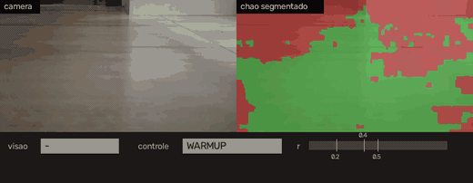
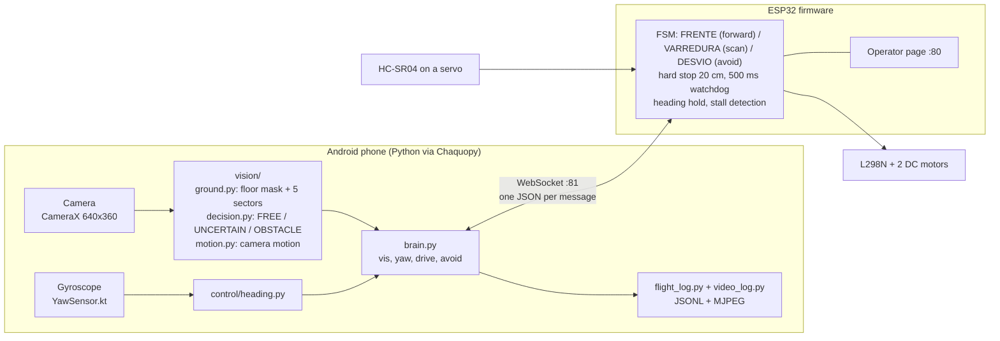

# Self-driving car with classical computer vision

**A toy car that avoids obstacles using only classical computer vision (no neural network) running on an Android phone, a range sensor and a gyroscope, with an ESP32 as the single executor of every maneuver.**


-e7352c)

<p align="center">
  
</p>
<p align="center"><sub>Replay of a run recorded by the car's own camera (24 s of 36). Left: camera. Right: floor segmentation (green = floor). Bottom: vision state, controller state of the offline replay and the relative confidence <code>r</code> with its thresholds.</sub></p>
<p align="center"><sub>☹️ <b>In this run the car hits the wall, and it should not have.</b> The sensor sweeps in 15° steps, and with the car at a diagonal to the wall, some step would face it side-on, the echo would come back and the sensor would cover its own limitation. Unfortunately we ran into loose-contact (bad wiring) problems, and for now the project is paused. See <a href="#limitations">Limitations</a>.</sub></p>


> 🇧🇷 Versão em português: [README.pt-BR.md](README.pt-BR.md). The technical documents in [`docs/`](docs/README.md) are in Brazilian Portuguese, except the architecture notes and the engineering decisions, which are in English.
>
> **Jump to:** [What it does](#what-it-does) · [Architecture](#architecture) · [Results](#results) · [Limitations](#limitations) · [Replicate it](#replicate-it) · [Repository layout](#repository-layout) · [Next steps](#next-steps)

## What it does

- **Obstacle avoidance by vision + sonar.** The phone learns what "floor" looks like from the first frames of each run (hue-saturation histogram, no training data) and estimates the free floor ahead in five sectors. An ultrasonic sensor on a servo scans the sides; the ESP32 fuses both, with the sensor having the final say.
- **Heading hold with the gyroscope.** The phone streams its yaw to the ESP32, which runs a PI loop on straights, plus a trim and a per-wheel duty range that are learned and stored in the ESP32's flash (NVS).
- **Crash detection by the camera.** If the wheels are pushing but the camera sees (almost) no motion, the firmware backs off. The motion index is computed on the phone (`vision/motion.py`) and sent with every vision opinion.
- **Runs recorded as data.** Each run saves a JSONL log and the camera video on the phone, downloadable from the operator page, to be replayed offline or used as a dataset.
- **Operator page served by the ESP32** (no app needed): arm, choose the mode, stop, run diagnostics, watch the sensor radar and the vision mask.


**Context.** The design was informed by studying how Waymo and Tesla approach perception: a redundant multi-sensor stack on one side, a camera-first stack on the other. This car is a toy-scale take on that trade-off: the camera is the main sensor and a cheap ultrasonic sensor adds redundancy where the camera is weak. Scale, safety requirements and methods are not comparable.

## Architecture

The ESP32 is the only executor of maneuvers. The phone does not run a state machine: it sends the vision's *opinion*, the *heading* from its gyroscope and, in vision mode, drive commands that the firmware can veto.



Per camera frame: segment the floor, turn the free-space estimate into one of three vision states, send it (with the heading and the camera-motion index) to the ESP32. The firmware keeps its own reflexes (hard stop, watchdog, arming) whatever the phone does. Details: [docs/architecture.md](docs/architecture.md), wire protocol: [docs/protocolo_ws.md](docs/protocolo_ws.md).

### Portuguese terms you will see

The code, logs and some file names are in Brazilian Portuguese. Quick reference:

| Term | Meaning |
|---|---|
| `FRENTE` / `VARREDURA` / `DESVIO` | firmware states: forward / scan (caution, slow) / avoid (maneuver) |
| `PARADA`, `OLHA`, `RE`, `CURVA`, `ESPERA`, `PRESO` | sub-steps of an avoid: stop, look (sweep the sensor), reverse, turn, wait, stuck |
| `LIVRE` / `INCERTO` / `OBSTACULO` | vision states: `FREE` / `UNCERTAIN` / `OBSTACLE` (the docs use the English names) |
| `vis`, `yaw`, `drive`, `avoid`, `m` | messages the phone sends: vision opinion, gyro heading, drive command, avoid command, camera-motion index |
| `corrida_*.jsonl` / `carrinho_*.jsonl` | run log from the phone / message log from the car (*corrida* = run, *carrinho* = little car) |
| `explorar` (*Explorar: sensor*, *Explorar: visao*) | "explore": drive on the sensor alone / with vision added |
| `parar`, `PARAR TUDO` | stop, STOP EVERYTHING (full reset) |
| `Baixar log`, `Aplicar faixa das rodas`, `Servo do sensor`, `Roda esq./dir. (degraus)` | operator page buttons: download log, apply wheel duty range, sensor servo test, left/right wheel (step) test |
| `protocolo_ws.md`, `exemplos_de_log/` | WebSocket protocol, log examples |
| `CARRINHO` | the car's Wi-Fi network name (*little car*) |

Design decisions (problem, choice and evidence for each): [docs/architecture.md#engineering-decisions](docs/architecture.md#engineering-decisions). Highlights:

- **Vision without training:** H-S histogram of the floor, back-projection, an automatic threshold from a percentile of the region of interest, morphology. Nothing to retrain when the floor changes.
- **Frame-rate independent decisions:** relative confidence with hysteresis and persistence in seconds; the same behavior at 5, 10 or 20 fps (covered by tests).
- **Safety in layers:** vision proposes, the sensor has the final say, the firmware enforces hard stop, watchdog and arming.
- **Each sensor covers the other's blind spot:** color vision cannot see a wall painted like the floor; the ultrasonic sensor can.
- **Hardware behind a simulator:** `sim/` runs the real firmware source on the PC against an independent physical model of wiring, wheels, servo and obstacles, so a wiring mistake shows up as a failed scenario.

## Results

**Cost per frame** (`tools/bench_s9.py`, 848x478 source, 105 to 106 frames, edge probe on):

| Platform (source fps) | Decode | Segmentation | Edge probe | Decision | Total |
|---|---|---|---|---|---|
| PC, 1 OpenCV thread (10) | 0.4 ms | 5.2 ms | 3.3 ms | < 0.05 ms | 8.5 ms |
| PC, 12 threads (10) | 0.4 ms | 5.7 ms | 3.9 ms | < 0.05 ms | 9.6 ms |
| Samsung Galaxy S9, 1 thread (30) | 2.4 ms | 9.9 ms | 7.6 ms | 0.1 ms | 17.6 ms |

On the S9 the pipeline computes at ~56 fps on the benchmark video; on the car (live 640x360 camera, plus sectors, motion and logging) it processed 22 to 26 frames per second at ~21 ms per frame, a fifth of the 100 ms budget. The run video is recorded at 10 fps. The 19 runs on the phone (1 to 4 threads) stay between 17.5 and 18.1 ms ([series](assets/simulation_Scar/Reframed_videos/docs/logs/bench/bench_s9_runs.txt)), so the vision runs with a single OpenCV thread.

**Tests:** 73 automated tests (`python -m pytest tests -q`) cover the vision decision at several frame rates, the heading controller, the brain/link logic, the live path as packaged for the phone, the log/video writers, the Python/firmware parameter mirror and the firmware itself, through the simulator.

**Firmware simulator:** 20 lettered scenarios plus the protocol and Python/firmware parameter checks, 143 checks in total (`sim/check_firmware.py`), all passing: diagonal wall with no echo, stopped obstacle (wait, then maneuver), side choice with and without echo, stale vision ignored, turn to an angle with and without yaw, full reset, sensor veto in phone mode, heading hold with unequal wheels, on-page diagnostics, reverse credit, sensor-servo faults and stall detection by camera motion.

**Offline replays** of recorded videos with a scripted sensor (`python -m replay.replay_main`), using the frozen v1 controller as the fusion reference:

| Scenario | Frames | Vision states (free / uncertain / obstacle) | What happened |
|---|---|---|---|
| Narrow corridor | 125 | 72 / 53 / 0 | no false obstacle |
| Open space, wall of similar color | 189 | 99 / 48 / 42 | edge probe flags the wall at 4.1 s, the sensor trips at 4.5 s, vision confirms at 4.7 s |
| Sofa with a nearby object | 105 | 30 / 12 / 63 | vision alone calls the obstacle at 2.1 s |

**Field validation** (20 to 26 Nov 2026, firmware 0.5.x to 0.7.0): per-wheel duty ranges, the heading-hold gains and the trim were measured on the car with the phone's gyroscope; the wiring was confirmed by the gyroscope, not by assumption. Example logs and how to read them: [docs/exemplos_de_log/](docs/exemplos_de_log/).


## Limitations

- **The car in the demo video crashes, and it should not have.** The ultrasonic sensor sweeps in 15° steps. With the car at a diagonal to the wall, one of those steps would end up facing the wall side-on, the echo would return and the sensor would work around its own limitation (a single beam only echoes back from surfaces close to perpendicular). That did not happen. We then ran into loose-contact (bad wiring) problems on the prototype, and **the project is currently paused**, so the cause was not isolated.
- **Crash detection by camera (0.7.0)** is covered by the simulator and caught one real crash in the field (26 Nov), but that is a single event: the thresholds (`stall_cam_max` and friends) are starting points to tune with recorded runs.
- **Hardware quirks shaped the design.** The two drive wheels respond very differently to the same duty, which is why the duty range is stored per wheel and the heading is closed on the gyroscope. The sensor servo had intermittent wiring on the prototype (signal moved to GPIO4); the operator page has a servo test for that.
- **Vision alone does not solve a wall whose color is close to the floor's.** The color model under-reacts, the edge probe needs a visible baseboard and optical flow did not help. The range sensor covers this case, which is why it is the authority. A learned monocular depth model is the candidate next step.
- **Replays use a scripted sensor.** They show that the logic behaves sensibly, not detection accuracy. There is no labeled benchmark yet.
- **The floor model assumes free floor at the start** (it learns from the first 0.9 s) and the camera is monocular: distance comes only from the ultrasonic sensor.
- **One environment.** All validation was done in one home with a light tiled floor; other floors and lighting are untested.

## Replicate it

**Without the car** (Python 3.10 or 3.11):

```bash
python -m venv venv && source venv/bin/activate        # Windows: venv\Scripts\activate
pip install -r requirements.txt pytest                 # PC only; requirements_phone.txt is for Chaquopy

python -m pytest tests -q
python main.py assets/simulation_Scar/Reframed_videos/10sec_reframed10.mp4 --csv run.csv   # vision loop on a video
python -m replay.replay_main assets/simulation_Scar/Reframed_videos/10sec_reframed10.mp4 --out run_sofa
python -m tools.make_demo                              # regenerates docs/media/demo_replay.gif
```

Firmware simulator (needs `g++`): `cd sim && g++ -std=c++17 -O1 -static -DESP_ARDUINO_VERSION_MAJOR=3 -I. -o sim3 sim.cpp && python check_firmware.py`

**With the car**

*Hardware:* ESP32 dev board, L298N driver, two DC gear motors on the front wheels (rear wheels free), HC-SR04 on a micro servo, an Android phone mounted facing forward (Galaxy S9 here), a 1k/2k divider on the HC-SR04 ECHO line (it is 5 V), two power sources with a common GND: a 12 V battery pack feeds the L298N, whose 5 V output (plus its GND) powers the ESP32 and the HC-SR04 (this was done to stop constant brownouts); a separate 9 V battery feeds only the servo, stepped down to 5 V by an LM2596 buck module (HW-411).

*Pinout (firmware 0.7.0):*

| Function | GPIO | Notes |
|---|---|---|
| Left wheel (L298N ENA / IN1 / IN2) | **13** / 16 / 17 | ENA moved from GPIO19, which was defective on the prototype |
| Right wheel (ENB / IN3 / IN4) | 32 / 33 / 21 | remove the ENB jumper on the L298N |
| HC-SR04 TRIG / ECHO | 23 / 22 | ECHO through the divider |
| Sensor servo signal | **4** | GPIO18 did not output PWM on the prototype |
| Arm button / LED | 0 (BOOT) / 2 | |

The wheel directions are fixed in the firmware (`MOTOR_LEFT_INVERT` / `MOTOR_RIGHT_INVERT` = 1 for this car); with other motors or wiring, the *per-wheel test* on the operator page tells you which wheel turned and which way, measured by the phone's gyroscope.

*Steps:*

1. **Firmware.** Copy `car_firmware/secrets.example.h` to `car_firmware/secrets.h` (git-ignored) and set the Wi-Fi password (without it the access point uses a public default). Build `car_firmware/car_firmware.ino` with the Arduino ESP32 core 3.x and the *WebSockets* library (Markus Sattler).
2. **App.** Build `android/` in Android Studio (Chaquopy runs the Python code; Gradle copies the sources): [docs/android.md](docs/android.md).
3. **First use through the operator page.** Join the `CARRINHO` Wi-Fi on a second phone and open `http://192.168.4.1`. Run the per-wheel test (*Roda esq./dir. (degraus)*, "left/right wheel (steps)") and *Aplicar faixa das rodas* ("apply wheel range"), then *Servo do sensor* ("sensor servo"). Press *Explorar: sensor* ("explore: sensor", sonar only) first; after 4 s the car arms and drives. With the app running on the camera phone, *Explorar: visao* ("explore: vision") adds the vision. *PARAR TUDO* ("stop everything") resets everything.
4. **Logs.** *Baixar log* ("download log") on the operator page, or `http://<phone-ip>:8080/logs` for the phone's runs; format in [docs/exemplos_de_log/](docs/exemplos_de_log/README.md). Convert a run video with `python -m tools.video_to_mp4 <log folder>`.


## Repository layout

```
vision/         floor segmentation, decision state machine, free-space sectors, camera motion, edge probe
control/        heading hold (live); hal.py, mocks.py and the frozen v1 controller (replay and tests only)
config.py       every tunable value in one place (firmware parameters are mirrored and checked by a test)
main.py         live vision path (StreamRunner); no maneuver decisions
brain.py        link to the ESP32: vision opinion, heading, drive/avoid, run log and video
viz.py          MJPEG viewer of the vision, served by the phone
car_firmware/   ESP32 firmware (FSM, motors, heading hold, operator page)
android/        Android app (Chaquopy + CameraX + gyroscope)
sim/            firmware simulator on the PC with an independent physical model
replay/         offline replays with a scripted sensor (not in the live path)
tools/          WebSocket link, run logs, video converters, benchmarks, demo GIF
tests/          73 tests
docs/           documentation (index in docs/README.md), example logs, media
assets/         recorded videos for replays and benchmarks
```

Where to start reading the code: [docs/README.md](docs/README.md).

## Next steps

- **Learn from the recorded runs.** Every run is already a dataset (frames + vision opinion + sonar + gyro + commands). Next: label the crashes and free paths from those runs and train a small model for monocular depth or free-space, comparing it against the classical pipeline.
- Field validation of crash detection and tuning of its thresholds with the recorded runs.
- A labeled benchmark for the vision decision.

## License

[MIT](LICENSE)

## Contact

Alvaro Danko · [alvarodanko032@gmail.com](mailto:alvarodanko032@gmail.com) · [LinkedIn](https://www.linkedin.com/in/alvaro-danko/) · [GitHub](https://github.com/allvaret)
