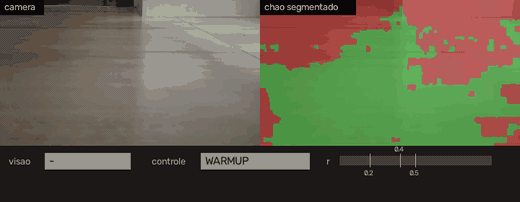
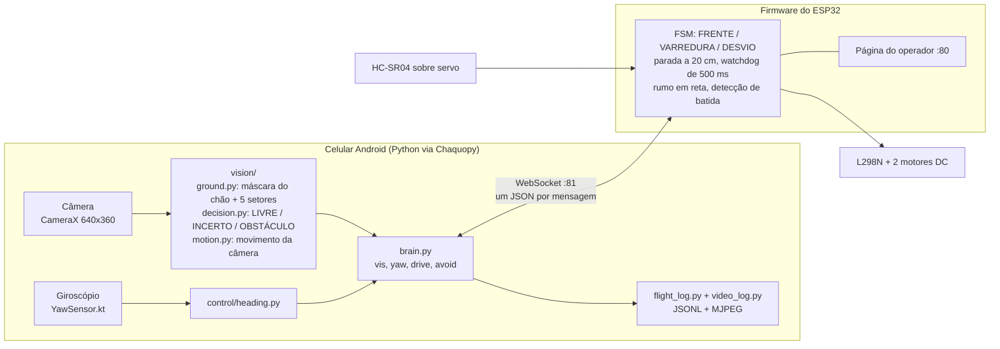

# Carro autônomo com visão computacional clássica

**Um carrinho que desvia de obstáculos usando só visão computacional clássica (sem rede neural) rodando em um celular Android, um sensor de distância e um giroscópio, com um ESP32 como único executor de todas as manobras.**


-e7352c)

<p align="center">
  
</p>
<p align="center"><sub>Replay de uma corrida gravada pela câmera do próprio carro (24 s de 36). Esquerda: câmera. Direita: segmentação do chão (verde = chão). Embaixo: estado da visão, estado do controlador do replay offline e a confiança relativa <code>r</code> com seus limiares.</sub></p>

<!-- MIDIA 1 (topo do README, substitui ou complementa o GIF acima): GIF/MP4 do carro de verdade andando e desviando de um obstáculo. Ver docs/media/LISTA_DE_GRAVACAO.md, tomada 1. -->

> 🇬🇧 English version: [README.md](README.md). Os documentos técnicos em [`docs/`](docs/README.md) estão em português, exceto as notas de arquitetura e as decisões de engenharia, em inglês.
>
> **Ir para:** [O que faz](#o-que-faz) · [Arquitetura](#arquitetura) · [Resultados](#resultados) · [Limitações](#limitações) · [Como replicar](#como-replicar) · [Estrutura](#estrutura-do-repositório) · [Próximos passos](#próximos-passos)

## O que faz

- **Desvio de obstáculos por visão + sonar.** O celular aprende como é o "chão" nos primeiros quadros de cada corrida (histograma matiz-saturação, sem dados de treino) e estima o chão livre à frente em cinco setores. Um sensor ultrassônico sobre um servo varre os lados; o ESP32 une os dois, e o sensor tem a palavra final.
- **Rumo em linha reta com o giroscópio.** O celular envia o rumo (yaw) ao ESP32, que roda um PI nas retas, com um trim e uma faixa de duty por roda aprendidos e guardados na flash do ESP32 (NVS).
- **Detecção de batida pela câmera.** Se as rodas empurram mas a câmera quase não vê movimento, o firmware dá ré. O índice de movimento é calculado no celular (`vision/motion.py`) e enviado junto com cada opinião da visão.
- **Corridas gravadas como dados.** Cada corrida salva um log JSONL e o vídeo da câmera no celular, baixáveis pela página do operador, para replay offline ou uso como conjunto de dados.
- **Página do operador servida pelo ESP32** (sem app): armar, escolher o modo, parar, rodar diagnósticos, ver o radar do sensor e a máscara da visão.

<!-- MIDIA 3 (visor): print/gravação em tela cheia do visor no celular, com a imagem da visão expandida. Ver docs/media/LISTA_DE_GRAVACAO.md, tomada 3. -->

**Contexto.** O projeto nasceu do estudo de como Waymo e Tesla tratam a percepção: de um lado, vários sensores redundantes; do outro, uma pilha baseada só em câmeras. O carrinho é uma versão em miniatura desse dilema: a câmera é o sensor principal e um sensor ultrassônico barato dá redundância onde a câmera é fraca. Escala, requisitos de segurança e métodos não são comparáveis.

## Arquitetura

O ESP32 é o único executor de manobras. O celular não tem máquina de estados: envia a *opinião* da visão, o *rumo* do giroscópio e, no modo visão, comandos de direção que o firmware pode vetar.



Por quadro: segmenta o chão, converte a estimativa de espaço livre em um de três estados da visão e envia (com o rumo e o índice de movimento da câmera) ao ESP32. O firmware mantém seus próprios reflexos (parada, watchdog, armação) independentemente do celular. Detalhes: [docs/architecture.md](docs/architecture.md); protocolo: [docs/protocolo_ws.md](docs/protocolo_ws.md); fluxo de execução: [docs/desenvolvimento/fluxo_de_execucao.md](docs/desenvolvimento/fluxo_de_execucao.md).

Decisões de projeto (problema, alternativa descartada e evidência de cada uma): [docs/engineering-decisions.md](docs/engineering-decisions.md). Destaques:

- **Visão sem treino:** histograma H-S do chão, retroprojeção, limiar automático por percentil da região de interesse, morfologia. Nada a retreinar quando o piso muda.
- **Decisão independente da taxa de quadros:** confiança relativa com histerese e persistência em segundos; o mesmo comportamento a 5, 10 ou 20 fps (coberto por testes).
- **Segurança em camadas:** a visão propõe, o sensor decide, o firmware impõe parada, watchdog e armação.
- **Cada sensor cobre o ponto cego do outro:** a visão por cor não enxerga uma parede pintada como o piso; o ultrassom enxerga.
- **Hardware atrás de um simulador:** `sim/` roda o código real do firmware no PC contra um modelo físico independente de fiação, rodas, servo e obstáculos; um erro de fiação aparece como cenário reprovado.

## Resultados

**Custo por quadro** (`tools/bench_s9.py`, fonte 848x478, 105 a 106 quadros, sonda de bordas ligada):

| Plataforma (fps da fonte) | Decodificação | Segmentação | Sonda de bordas | Decisão | Total |
|---|---|---|---|---|---|
| PC, 1 thread OpenCV (10) | 0,4 ms | 5,2 ms | 3,3 ms | < 0,05 ms | 8,5 ms |
| PC, 12 threads (10) | 0,4 ms | 5,7 ms | 3,9 ms | < 0,05 ms | 9,6 ms |
| Samsung Galaxy S9, 1 thread (30) | 2,4 ms | 9,9 ms | 7,6 ms | 0,1 ms | 17,6 ms |

No S9 o pipeline calcula a ~56 fps: acompanha uma fonte de 30 fps e sobra ~5,7x de folga aos 10 fps em que o carro roda. As 19 execuções no celular (1 a 4 threads) ficam entre 17,5 e 18,1 ms ([série](assets/simulation_Scar/Reframed_videos/docs/logs/bench/bench_s9_runs.txt)); por isso a visão roda com uma única thread do OpenCV.

**Testes:** 73 testes automatizados (`python -m pytest tests -q`) cobrem a decisão da visão em várias taxas de quadros, o controlador de rumo, a lógica do brain e do enlace, o caminho ao vivo como empacotado para o celular, os gravadores de log e vídeo, o espelho de parâmetros Python/firmware e o próprio firmware, pelo simulador.

**Simulador do firmware:** 20 cenários rotulados, mais as verificações de protocolo e do espelho de parâmetros Python/firmware, 143 verificações no total (`sim/check_firmware.py`), todas passando: parede diagonal sem eco, obstáculo parado (espera e depois manobra), escolha de lado com e sem eco, visão velha ignorada, curva até um ângulo com e sem yaw, reset completo, veto do sensor no modo celular, rumo em reta com rodas desiguais, diagnósticos da página, crédito de ré, falhas do servo do sensor e detecção de batida pelo movimento da câmera.

**Replays offline** de vídeos gravados com sensor roteirizado (`python -m replay.replay_main`), usando o controlador v1 congelado como referência de fusão:

| Cenário | Quadros | Estados da visão (livre / incerto / obstáculo) | O que aconteceu |
|---|---|---|---|
| Corredor estreito | 125 | 72 / 53 / 0 | nenhum falso obstáculo |
| Espaço aberto, parede de cor parecida | 189 | 99 / 48 / 42 | a sonda de bordas acusa a parede em 4,1 s, o sensor dispara em 4,5 s, a visão confirma em 4,7 s |
| Sofá com objeto próximo | 105 | 30 / 12 / 63 | só a visão chama o obstáculo em 2,1 s |

**Validação em campo** (20 a 26/11/2026, firmware 0.5.x a 0.7.0): faixas de duty por roda, ganhos do rumo e trim foram medidos no carro com o giroscópio do celular; a fiação foi confirmada pelo giroscópio, não por suposição. Registro dia a dia: [docs/desenvolvimento/diario_de_campo.md](docs/desenvolvimento/diario_de_campo.md). Logs de exemplo: [docs/exemplos_de_log/](docs/exemplos_de_log/).

<!-- MIDIA 2 (batida + ré + desvio): gravação de 10 a 15 s do carro batendo, dando ré e desviando. Ver docs/media/LISTA_DE_GRAVACAO.md, tomada 2. -->

## Limitações

- **A detecção de batida pela câmera (0.7.0)** está implementada e coberta pelo simulador, mas a validação em campo está planejada: os limiares (`stall_cam_max` e afins) são pontos de partida a ajustar com as corridas gravadas.
- **Particularidades do hardware moldaram o projeto.** As duas rodas de tração respondem de modo muito diferente ao mesmo duty; por isso a faixa de duty é guardada por roda e o rumo é fechado no giroscópio. O servo do sensor teve fiação intermitente no protótipo (sinal movido para o GPIO4); a página do operador tem um teste do servo para isso.
- **A visão sozinha não resolve parede de cor próxima à do piso.** O modelo de cor reage pouco, a sonda de bordas precisa de rodapé visível e o fluxo óptico não ajudou. O sensor de distância cobre esse caso, e por isso é a autoridade. Um modelo de profundidade monocular aprendido é o próximo candidato.
- **Os replays usam sensor roteirizado.** Mostram que a lógica se comporta de forma sensata, não a acurácia de detecção. Ainda não há benchmark rotulado.
- **O modelo de chão assume chão livre no início** (aprende nos primeiros 0,9 s) e a câmera é monocular: a distância vem só do ultrassom.
- **Um único ambiente.** Toda a validação foi em uma casa com piso claro de porcelanato; outros pisos e iluminações não foram testados.

## Como replicar

**Sem o carro** (Python 3.10 ou 3.11):

```bash
python -m venv venv && source venv/bin/activate        # Windows: venv\Scripts\activate
pip install -r requirements.txt pytest                 # só no PC; requirements_phone.txt é do Chaquopy

python -m pytest tests -q
python main.py assets/simulation_Scar/Reframed_videos/10sec_reframed10.mp4 --csv run.csv   # laço de visão sobre um vídeo
python -m replay.replay_main assets/simulation_Scar/Reframed_videos/10sec_reframed10.mp4 --out run_sofa
python -m tools.make_demo                              # regenera docs/media/demo_replay.gif
```

Simulador do firmware (precisa de `g++`): `cd sim && g++ -std=c++17 -O1 -static -DESP_ARDUINO_VERSION_MAJOR=3 -I. -o sim3 sim.cpp && python check_firmware.py`

**Com o carro**

*Hardware:* placa ESP32, driver L298N, dois motores DC com caixa de redução nas rodas dianteiras (traseiras livres), HC-SR04 sobre um microservo, um celular Android fixado olhando para frente (Galaxy S9 aqui), divisor 1k/2k na linha ECHO do HC-SR04 (ela é de 5 V) e alimentação separada para o servo com GND comum.

*Pinagem (firmware 0.7.0):*

| Função | GPIO | Observações |
|---|---|---|
| Roda esquerda (L298N ENA / IN1 / IN2) | **13** / 16 / 17 | o ENA saiu do GPIO19, que veio com defeito no protótipo |
| Roda direita (ENB / IN3 / IN4) | 32 / 33 / 21 | retire o jumper do ENB no L298N |
| HC-SR04 TRIG / ECHO | 23 / 22 | ECHO pelo divisor |
| Sinal do servo do sensor | **4** | o GPIO18 não entregou PWM no protótipo |
| Botão de armar / LED | 0 (BOOT) / 2 | |

O sentido de giro de cada roda é fixo no firmware (`MOTOR_LEFT_INVERT` / `MOTOR_RIGHT_INVERT` = 1 neste carro); com outros motores ou outra fiação, o *teste por roda* na página do operador diz qual roda girou e para que lado, medido pelo giroscópio do celular.

*Passos:*

1. **Firmware.** Copie `car_firmware/secrets.example.h` para `car_firmware/secrets.h` (ignorado pelo git) e defina a senha do Wi-Fi (sem ele, o ponto de acesso usa uma senha padrão pública). Compile `car_firmware/car_firmware.ino` com o core ESP32 3.x do Arduino e a biblioteca *WebSockets* (Markus Sattler).
2. **App.** Compile `android/` no Android Studio (o Chaquopy roda o código Python; o Gradle copia as fontes): [docs/android.md](docs/android.md).
3. **Primeiro uso pelo visor.** Conecte um segundo celular à rede Wi-Fi `CARRINHO` e abra `http://192.168.4.1`. Rode o teste por roda (*Roda esq./dir. (degraus)*) e *Aplicar faixa das rodas*, depois *Servo do sensor*. Aperte *Explorar: sensor* (só sonar) primeiro; após 4 s o carro arma e anda. Com o app rodando no celular da câmera, *Explorar: visao* soma a visão. *PARAR TUDO* faz o reset completo.
4. **Logs.** *Baixar log* na página do operador, ou `http://<ip-do-celular>:8080/logs` para as corridas do celular; formato em [docs/como_ler_o_log.md](docs/como_ler_o_log.md). Converta o vídeo de uma corrida com `python -m tools.video_to_mp4 <pasta dos logs>`.

<!-- MIDIA 4 (download do log): print da página /logs no navegador do celular. Ver docs/media/LISTA_DE_GRAVACAO.md, tomada 4. -->
<!-- MIDIA 5 (foto do hardware): foto do carro montado com a fiação atual, ao lado da tabela de pinagem. Ver docs/media/LISTA_DE_GRAVACAO.md, tomada 5. -->

## Estrutura do repositório

```
vision/         segmentação do chão, máquina de estados da decisão, setores de espaço livre, movimento da câmera, sonda de bordas
control/        rumo em reta (ao vivo); hal.py, mocks.py e o controlador v1 congelado (só replay e testes)
config.py       todos os valores ajustáveis em um só lugar (os do firmware têm espelho conferido por teste)
main.py         caminho ao vivo da visão (StreamRunner); sem decisões de manobra
brain.py        enlace com o ESP32: opinião da visão, rumo, drive/avoid, log e vídeo da corrida
viz.py          visualizador MJPEG da visão, servido pelo celular
car_firmware/   firmware do ESP32 (FSM, motores, rumo em reta, página do operador)
android/        app Android (Chaquopy + CameraX + giroscópio)
sim/            simulador do firmware no PC com modelo físico independente
replay/         replays offline com sensor roteirizado (fora do caminho ao vivo)
tools/          enlace WebSocket, logs da corrida, conversores de vídeo, benchmarks, GIF de demonstração
tests/          73 testes
docs/           documentação (índice em docs/README.md), logs de exemplo, mídia
assets/         vídeos gravados para replays e benchmarks
```

Por onde começar a ler o código: [docs/README.md](docs/README.md).

## Próximos passos

- **Aprender com as corridas gravadas.** Cada corrida já é um conjunto de dados (quadros + opinião da visão + sonar + giroscópio + comandos). Próximo: rotular batidas e caminhos livres dessas corridas e treinar um modelo pequeno de profundidade monocular ou espaço livre, comparando com o pipeline clássico.
- Validação em campo da detecção de batida e ajuste dos limiares com as corridas gravadas.
- Um benchmark rotulado para a decisão da visão.

## Licença

[MIT](LICENSE)

## Contato

Alvaro Danko · [alvarodanko032@gmail.com](mailto:alvarodanko032@gmail.com) · [LinkedIn](https://www.linkedin.com/in/alvaro-danko/) · [GitHub](https://github.com/allvaret)
