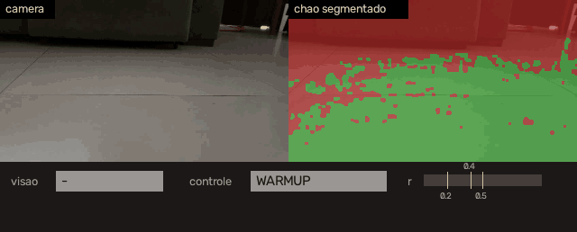
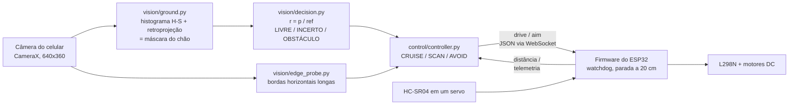

# Carro autônomo com visão computacional clássica

**Um carrinho autônomo cujo cérebro é um programa em Python rodando num celular e cujo corpo é um ESP32.** A câmera do celular é a única percepção: o chão é segmentado por histogramas de cor (sem rede neural nem GPU), uma máquina de estados decide, e o ESP32 aciona os motores e garante os limites de segurança. Cada frame custa cerca de 18 ms num Samsung S9.


-e7352c)

<p align="center">
  
</p>
<p align="center"><sub>Replay de uma corrida gravada (10 s, o carro indo em direção a um sofá). Esquerda: câmera. Direita: segmentação do chão (verde = chão). Embaixo: estado da visão, estado do controlador e a confiança <code>r</code> com seus limiares. O sensor de distância é simulado e o replay é em malha aberta.</sub></p>

> 🇬🇧 English version: [README.md](README.md)
>
> **Ir para:** [Decisões de engenharia](docs/engineering-decisions.md) (em inglês) · [Arquitetura](docs/architecture.md) (em inglês) · [Resultados](#resultados) · [Como rodar](#como-rodar) · [Estrutura](#estrutura-do-repositório)

## Visão geral

A pergunta do projeto era: até onde vai um pipeline de visão **clássico e explicável** em hardware modesto, antes de recorrer a um modelo treinado? O carro não tem mapa nem dataset. Ele aprende como é o "chão" nos primeiros frames de cada corrida, estima quanto espaço livre existe à frente e transforma isso em um comando de movimento.

O trabalho se divide em três camadas, ligadas por interfaces estreitas e testadas:

| Camada | Roda em | Responsabilidade |
|---|---|---|
| **Visão e decisão** | Python (PC, ou celular via Chaquopy) | segmentação do chão, estimativa de espaço livre, máquina de estados de obstáculo, controlador |
| **Enlace** | Wi-Fi (ponto de acesso do ESP32, WebSocket, uma mensagem JSON por frame) | comandos de ida, telemetria e logs de volta |
| **Corpo** | Firmware do ESP32 | motores (L298N), sensor ultrassônico em um servo, watchdog, parada de emergência |

**Contexto.** O projeto foi feito a partir do estudo de como Waymo e Tesla tratam a percepção: de um lado, vários sensores redundantes; do outro, uma pilha baseada só em câmeras. O carrinho é uma versão em miniatura desse dilema: a câmera é o sensor principal, e um sensor ultrassônico barato dá redundância onde a câmera é fraca. Escala, requisitos de segurança e métodos não são comparáveis.

O que eu destacaria:

- **Visão sem treinamento.** Histograma de matiz e saturação do chão, retroprojeção, limiar automático a partir de um percentil da região de interesse e morfologia. Sem dataset, sem rótulos, e nada a retreinar quando o piso muda.
- **Decisão independente da taxa de quadros.** O estado de obstáculo depende de uma confiança *relativa* a uma referência móvel, com histerese e persistência medidas em segundos. O comportamento é o mesmo a 5, 10 ou 20 fps (há testes para isso).
- **Segurança em camadas.** A visão propõe, o sensor de distância tem a palavra final, e o firmware impõe parada a 20 cm, watchdog de 500 ms e botão de armar, tudo independente do lado Python.
- **Um código, dois destinos.** O mesmo Python roda no PC e no celular. Uma camada de abstração de hardware com mocks permite repetir todo o laço de controle a partir de vídeo gravado, validando decisões sem o carro.
- **Medido, não suposto.** ~9 ms por frame no PC e ~18 ms no S9 (uma fonte de 30 fps é processada em tempo real). No PC, uma thread do OpenCV foi mais rápida que doze; no celular, de 1 a 4 threads custam o mesmo, então roda com uma.
- **Um sensor cobre o ponto cego do outro.** A visão por cor não enxerga uma parede pintada da cor do chão; o sensor ultrassônico enxerga. O controlador é construído em torno dessa divisão de trabalho.

## Status

**v1 concluída.** O pipeline de visão, o controlador, o firmware e o app Android funcionam de ponta a ponta. O comportamento foi validado por replay de corridas gravadas em três cenários (um sofá com objeto próximo, um corredor estreito e um espaço aberto com uma parede de cor próxima à do chão), por testes de bancada do firmware e por corridas em malha fechada no carro montado, com a visão do celular e o sensor ultrassônico comandando o ESP32.

A visão sozinha não resolve a parede de cor parecida; o sensor de distância resolve, e essa divisão de trabalho é a ideia central do projeto. Um dos motores de tração já veio com defeito no kit, o que limita o quanto o carro executa o que é comandado (veja [Limitações](#limitações)).

## Arquitetura



A cada frame: segmenta-se o chão, a estimativa de espaço livre vira um de três estados de visão, e uma pequena máquina de estados o combina com a sonda de bordas e com o sensor de distância para enviar um comando de movimento. O ESP32 mantém seus próprios reflexos (parada de emergência, watchdog, armamento) independentemente do celular, e também serve uma página web para operar e observar o carro. Detalhes, ligações elétricas e a página de operação: [docs/architecture.md](docs/architecture.md) (em inglês).

## Decisões de engenharia

Nove decisões, cada uma com o problema, a alternativa descartada e a evidência no repositório: modelo de chão aprendido na própria corrida, limiar derivado dos dados, confiança relativa com um estado "incerto", tempo em segundos em vez de frames, uma pista independente por bordas, fusão com o sensor acima da visão e reflexos no firmware, hardware atrás de mocks, desempenho medido, e experimentos fora do laço principal. Estão em [docs/engineering-decisions.md](docs/engineering-decisions.md) (em inglês).

## Resultados

**Replay de corridas gravadas** (`python -m replay.replay_main`; sensor de distância simulado a partir de uma linha do tempo escrita à mão, 10 fps). Os logs ficam em [`assets/.../docs/logs/run/`](assets/simulation_Scar/Reframed_videos/docs/logs/run).

| Cenário | Frames | Estados da visão (livre / incerto / obstáculo) | Controlador (cruise / scan / avoid) | O que aconteceu |
|---|---|---|---|---|
| Corredor estreito | 125 | 72 / 53 / 0 | 63 / 62 / 0 | nenhum falso obstáculo; o carro segue andando e varrendo |
| Espaço aberto, parede de cor parecida | 189 | 99 / 48 / 42 | 43 / 58 / 88 | a sonda de bordas aponta a parede aos 4,1 s, o sensor dispara aos 4,5 s (começa o desvio) e a visão confirma aos 4,7 s |
| Sofá com objeto próximo | 105 | 30 / 12 / 63 | 27 / 18 / 60 | só a visão declara o obstáculo aos 2,1 s e dispara o desvio, sem leitura de sensor para contestar |

**Custo por frame** (`tools/bench_s9.py`, fonte de 848x478, 105 a 106 frames, sonda de bordas ligada):

| Plataforma (fps da fonte) | Decodificação | Segmentação | Sonda de bordas | Decisão + controlador | Total |
|---|---|---|---|---|---|
| PC, 1 thread do OpenCV (10) | 0,4 ms | 5,2 ms | 3,3 ms | < 0,05 ms | 8,5 ms |
| PC, 12 threads (10) | 0,4 ms | 5,7 ms | 3,9 ms | < 0,05 ms | 9,6 ms |
| Samsung S9, 1 thread (30) | 2,4 ms | 9,9 ms | 7,6 ms | 0,1 ms | 17,6 ms |

No S9 o pipeline calcula a ~56 fps: acompanha uma fonte de 30 fps (orçamento de 33 ms) e tem cerca de 5,7 vezes de folga nos 10 fps em que o carro opera. A série completa no celular (19 execuções, de 1 a 4 threads) está em [`bench_s9_runs.txt`](assets/simulation_Scar/Reframed_videos/docs/logs/bench/bench_s9_runs.txt); os totais ficam entre 17,5 e 18,1 ms.

**Testes:** 24 testes automatizados (`pytest tests`) cobrem a máquina de estados do controlador, os limiares de decisão em várias taxas de quadros, o laço de execução, a conversão de frames do Android e um pipeline sintético de ponta a ponta.

## Limitações

- **A fidelidade do movimento é limitada pelo hardware.** Um dos motores de tração tinha defeito na caixa de redução desde o início. Os dois lados divergem: o mais forte puxa mais corrente e acelera ainda mais, então até um comando em linha reta vira curva. Uma correção por software da força do motor não se sustentou. As corridas em malha fechada foram qualitativas; os resultados quantitativos aqui vêm de replays e benchmarks, e as constantes de força do motor são os únicos valores calibrados no carro.
- **A visão sozinha não resolve uma parede de cor próxima à do chão.** O modelo de cor reage pouco, a sonda de bordas precisa de um rodapé visível e o fluxo óptico não ajudou. O sensor de distância cobre esse caso, e por isso o controlador o trata como autoridade. Um modelo aprendido de profundidade monocular é o próximo passo candidato.
- **Os replays usam um sensor roteirizado.** As linhas do tempo foram escritas à mão a partir dos vídeos, então mostram que a lógica se comporta de forma coerente, não a precisão da detecção. Não há benchmark com rótulos.
- **Os demais parâmetros são valores de demonstração ou hipótese** (velocidades, taxa de giro, vários limiares); veja [`docs/parametros_a_calibrar.md`](docs/parametros_a_calibrar.md).
- **O modelo de chão pressupõe chão livre no início** (aprende com os primeiros 0,9 s) e a câmera é monocular, então a distância vem apenas do sensor ultrassônico.
- **Poucos dados de validação e um simulador legado.** Três gravações em uma casa, das quais só o vídeo do sofá está no repositório (os outros mostram ambientes privados; os logs estão). O `sim/` mira o firmware v0.2 e não compila contra a v0.3.

## Como rodar

**Sem o carro** (Python 3.10 ou 3.11):

```bash
python -m venv venv && source venv/bin/activate        # Windows: venv\Scripts\activate
pip install -r requirements.txt pytest

# roda o laço completo no vídeo do sofá (sensor simulado) e imprime as transições do controlador
python main.py assets/simulation_Scar/Reframed_videos/10sec_reframed10.mp4 --csv run_sofa.csv

# replay com um cenário de sensor roteirizado; gera um CSV e um gráfico
python -m replay.replay_main assets/simulation_Scar/Reframed_videos/10sec_reframed10.mp4 --out run_sofa

python -m tools.make_demo        # regenera docs/media/demo_sofa.gif
python -m pytest tests -q        # 24 testes
```

**Com o carro** (ESP32, L298N, HC-SR04 em um servo, um celular Android):

1. Firmware: copie `car_firmware/secrets.example.h` para `secrets.h` e defina a senha do Wi-Fi; depois compile `car_firmware/car_firmware.ino` com o core ESP32 3.x do Arduino e a biblioteca *WebSockets* (Markus Sattler). Segure o BOOT por 3 s para armar. Ligações e protocolo: [`docs/architecture.md`](docs/architecture.md), [`docs/protocolo_ws.md`](docs/protocolo_ws.md).
2. Celular: compile o projeto `android/` no Android Studio (o Chaquopy executa o código Python; o Gradle copia os fontes). Passo a passo: [`docs/android.md`](docs/android.md).
3. Conecte-se à rede Wi-Fi `CARRINHO` e abra `http://192.168.4.1`.

## Estrutura do repositório

```
vision/         segmentação do chão, máquina de estados de decisão, sonda de bordas (+ experimento de fluxo óptico)
control/        máquina de estados do controlador e abstração de hardware (hal.py)
config.py       todos os valores ajustáveis em um só lugar
main.py         laço de frames (Runner) e replay por linha de comando
brain.py, viz.py   lado do celular no enlace com o ESP32, e o visor MJPEG
replay/         replay com sensor simulado
car_firmware/   firmware do ESP32
android/        app Android (Chaquopy + CameraX)
sim/            simulador do firmware v0.2 no computador (legado)
tools/          benchmarks, extração de frames, rotulagem, GIF de demonstração
tests/          24 testes
docs/           arquitetura, decisões de projeto, protocolo, lista de calibração
assets/         vídeo do sofá, logs e rótulos
```

## Licença

[MIT](LICENSE)

## Contato

Alvaro Danko · [alvarodanko032@gmail.com](mailto:alvarodanko032@gmail.com) · [LinkedIn](https://www.linkedin.com/in/alvaro-danko/) · [GitHub](https://github.com/allvaret)
