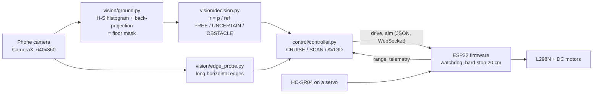
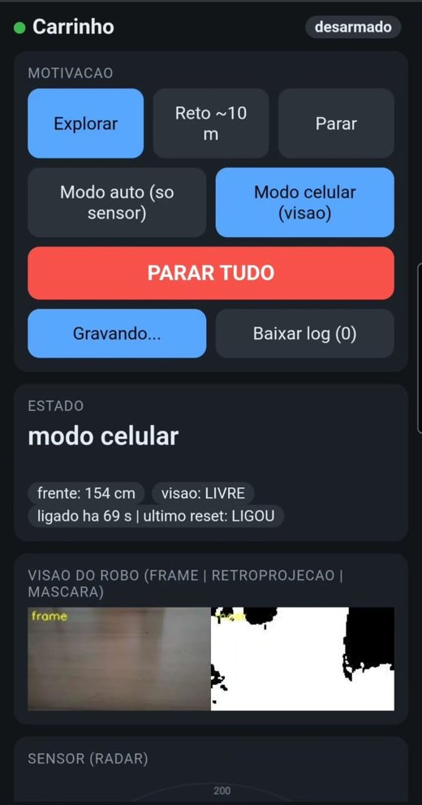

# Architecture

Each frame goes through the same path, on the PC or on the phone:

1. **Segmentation** (`vision/ground.py`). The first frames of a run teach a hue-saturation histogram of the floor. Every later frame is back-projected onto it; the threshold is derived from a low percentile of the region of interest, then cleaned with a median blur and morphology. `free_space_vector` reduces the mask to free depth per column strip.
2. **Features** (`vision/coverage_log.py`). Per frame: floor fraction and mean floor probability in the lower band (full width and central third), and the fraction of pixels too dark or too bright for hue to be trusted.
3. **Vision state** (`vision/decision.py`). Mean central probability divided by a reference (the median over the last 0.9 s) gives a relative confidence `r`. Thresholds on `r` with hysteresis and persistence in seconds produce `FREE`, `UNCERTAIN` or `OBSTACLE` (`LIVRE`, `INCERTO`, `OBSTÁCULO` in the code).
4. **Edge probe** (`vision/edge_probe.py`). Automatic Canny keeps only long, nearly horizontal edges (the wall-floor contact line, i.e. the baseboard) and reports how far up the image the first one sits. It covers walls whose color is close to the floor's, where the color model alone is weak.
5. **Controller** (`control/controller.py`). A state machine fuses vision with the range sensor. `CRUISE` drives forward; `SCAN` sweeps the sensor left and right; `AVOID` backs up and turns (`STOP`, `LOOK_L`, `LOOK_R`, `REVERSE`, `TURN`, `WAIT`, `HOLD`). The sensor has the final say over vision, and a re-entry guard makes the car pause when it keeps avoiding in a short window (a third `AVOID` within 20 s waits 1 s first).
6. **Actuation** (`car_firmware/`). The ESP32 receives drive and aim commands, moves the motors and servo, and stops on its own if commands stop arriving or something is closer than 20 cm.

| Layer | Code | Interface |
|---|---|---|
| Perception and decision | `vision/`, `control/`, `config.py` | pure functions and small classes; no I/O |
| Hardware abstraction | `control/hal.py` | range head and drive link as small interfaces: `LinkRangeHead` / `LinkDrive` over serial, WebSocket (`tools/ws_link.py`) or memory, and `MockRangeHead` / `MockDriveLink` for replay and tests |
| Run loop | `main.py` (`Runner`, `StreamRunner`), `brain.py` | `feed(frame, t)` returns one telemetry dict per frame |
| Phone app | `android/` | CameraX frames to Python through Chaquopy |
| Firmware | `car_firmware/` | JSON, one message per line, same format on serial and WebSocket; soft AP `CARRINHO`, HTTP on 80, WebSocket on 81 |

All tunable values live in one `config.py`, and the ones that still need measuring on the real car are listed in [`docs/parametros_a_calibrar.md`](parametros_a_calibrar.md). The wire protocol is documented in [`docs/protocolo_ws.md`](protocolo_ws.md).

## Operator view

The ESP32 serves a single web page at `http://192.168.4.1` (no app to install) that any phone can open once connected to the car's Wi-Fi. It is how the car is operated and observed while it runs:

- **Motivation** (goal): *explore*, *go straight ~10 m*, *stop*. It is relayed to the brain on the phone and to every connected client.
- **Mode**: *auto* (sensor only, the ESP32 drives alone) or *phone* (the vision brain drives). **STOP ALL** disarms immediately.
- **State**: distance ahead, vision state, uptime and the reason of the last reset (the firmware reports brownouts).
- **Robot's view**: frame, back-projection and mask, streamed as MJPEG by the phone (`viz.py`); the image does not pass through the ESP32. It is low resolution because that is what reaches the pipeline (320 px wide); the visible floor ahead spans about 130 cm (measured).
- **Thought**: the brain publishes short `think` messages (text, state, confidence) that the page shows next to the sensor radar. A log can be recorded and downloaded from the page.

(The interface text is in Portuguese.)

## Wiring and drive

Differential drive: two DC motors on an L298N, no steering servo. The ultrasonic sensor sits on its own servo so the car can look left and right.

| Signal | ESP32 pin | Note |
|---|---|---|
| HC-SR04 TRIG / ECHO | 23 / 22 | ECHO is 5 V, so it goes through a 1k/2k divider |
| Sensor servo | 18 | |
| L298N ENA / IN1 / IN2 | 19 / 16 / 17 | PWM on ENA |
| L298N ENB / IN3 / IN4 | 32 / 33 / 21 | PWM on ENB, remove the ENB jumper |
| BOOT button / LED | 0 / 2 | arm and disarm / status |

Motor start-up is staggered (one at a time, never while the servo moves) to avoid brownouts, and the firmware reports the reset reason when it recovers from one.
