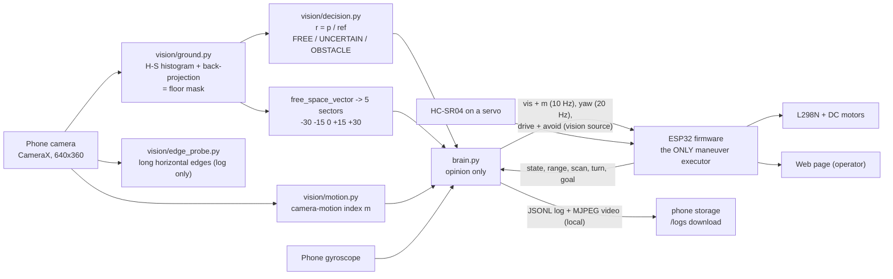
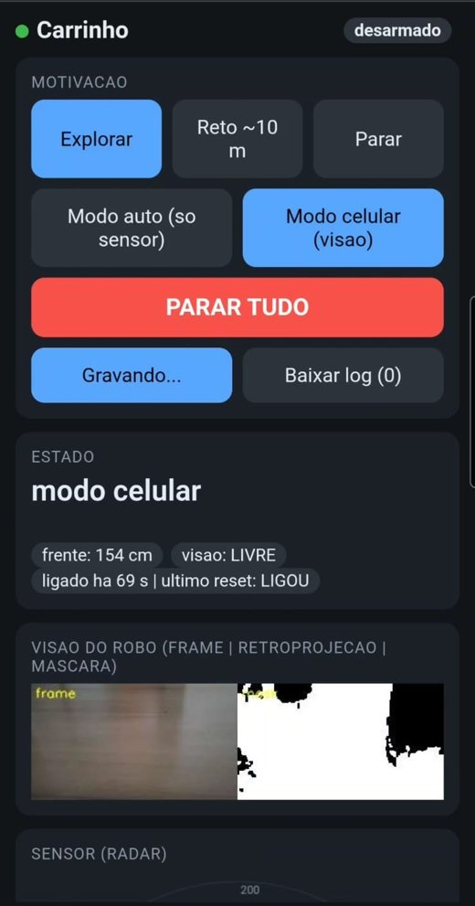

# Architecture

Each frame goes through the same path, on the PC or on the phone. **The ESP32 is the only executor of maneuvers.** The phone has no state machine; it sends the vision's *opinion*, the camera-motion index and the gyroscope heading, and the firmware stops, sweeps, picks an angle and turns.

1. **Segmentation** (`vision/ground.py`). The first frames of a run teach a hue-saturation histogram of the floor. Every later frame is back-projected onto it; the threshold is derived from a low percentile of the region of interest, then cleaned with a median blur and morphology.
2. **Features** (`vision/coverage_log.py`). Per frame: floor fraction and mean floor probability in the lower band (full width and central third), and the fraction of pixels too dark or too bright for hue to be trusted.
3. **Vision state** (`vision/decision.py`). Mean central probability divided by a reference (the median over the first 0.9 s) gives a relative confidence `r`. Thresholds on `r` with hysteresis and persistence in seconds produce `FREE`, `UNCERTAIN` or `OBSTACLE` (`LIVRE`, `INCERTO`, `OBSTACULO` in the code).
4. **Free-space sectors** (`vision/ground.free_space_vector` + `free_sectors`). The 40 strips (8 px each at 320 px) are reduced to 5 sectors aligned with the sensor servo (-30, -15, 0, +15, +30°, horizontal FOV ~74°); each value is the 20th percentile of its 8 strips, 0..100. Image left = car left.
5. **Edge probe** (`vision/edge_probe.py`). Automatic Canny keeps only long, nearly horizontal edges (the wall-floor contact line) and reports how far up the image the first one sits. It is logged, not used to decide.
6. **Camera motion** (`vision/motion.py`). Mean absolute difference between 64 px gray thumbnails 0.3 s apart, with the mean brightness removed: ~0.5-3 when the car is still, ~5-40 when it drives. The firmware uses it to detect a crash the sonar cannot see.
7. **Brain** (`brain.py`, the only owner of the WebSocket). Reads `vision_state` by exact equality, sends `vis` (ok flag + 5 sectors + `m`, ~10 Hz) and `yaw` (unbounded heading `psi` and rate, ~20 Hz, from the phone gyroscope). With the *vision* source it also sends `drive` (speed from the vision state: 0.35 / 0.15 / 0; steering 0, the ESP32 holds the heading) and, on `OBSTACLE`, `avoid` with the freest sector's angle (at most every 2 s), unless a valid, fresh centre reading ≥ `d_clear` refutes the vision (then it drives at `V_SLOW` and sends no `avoid`; the ESP32 applies the same refusal on its side). It writes the run log and video.
8. **Firmware** (`car_firmware/`). The ESP32 runs FRENTE / VARREDURA / DESVIO (details below), keeps the reflexes (20 cm hard stop, 500 ms watchdog, 4 s arming, reverse limit), holds the heading on straights with the phone's gyro and detects crashes from `m`.

*The `control/controller.py` state machine is frozen: it is the v1 reference and is used only by `replay/`, `tools/bench_s9.py` and the tests. The live path (`main.py`, `brain.py`, `viz.py`, `ws_link.py`) does not import it, nor the mocks; `tests/test_live_path.py` enforces this.*

| Layer | Code | Interface |
|---|---|---|
| Perception | `vision/`, `control/heading.py`, `config.py` | pure functions and small classes; no I/O |
| Hardware abstraction | `control/hal.py`, `control/mocks.py` | `Drive`, `Reading`, `LinkRangeHead` / `LinkDrive` over serial or memory (`hal.py`); `MockRangeHead` / `MockDriveLink` / `Scenario` for replay and tests only (`mocks.py`) |
| Run loop | `main.py` (`VisionRunner`, `StreamRunner`), `brain.py`; offline: `replay/offline.py` | `feed(frame, t)` returns the vision opinion per frame (`vision_state`, `r`, `sectors`, `edge_*`, `mov`, `ok`) |
| Phone app | `android/` | CameraX frames to Python through Chaquopy |
| Firmware | `car_firmware/` | JSON, one message per line, same format on serial and WebSocket; soft AP `CARRINHO`, HTTP on 80, WebSocket on 81 |

All tunable values live in `config.py`; the firmware parameters are mirrored there and `tests/test_config_firmware.py` checks the mirror. The ones that depend on the hardware (per-wheel duty range, trim, stall thresholds) are starting points to adjust when replicating the car, mostly from the operator page. The wire protocol is in [`protocolo_ws.md`](protocolo_ws.md).

## Execution path on the phone (frame → ESP32)

| # | Where | What happens |
|---|---|---|
| 0 | `LiveActivity.onResume` → `BrainBridge.start` | starts `WsLink` (auto-reconnect), `viz` (MJPEG on :8080, `/logs`, `/play`) and the run log |
| 1 | CameraX → `LiveActivity.analyze` | RGBA 640×360, single-thread executor, `KEEP_ONLY_LATEST` |
| 2 | `main.StreamRunner.process_rgba_frame` → `VisionRunner.feed` | SETTLE (1 s, `ok=0`) → WARMUP (11 frames, `ok=0`) → RUN: mask → sectors → decision → edges → motion. Returns JSON |
| 3 | `BrainBridge.step` → `brain.step` | parses the JSON, sends `vis` (~10 Hz); sends `mode` only when the goal or source changes or the link reconnects; **never arms** |
| 4 | `YawSensor` (~50 Hz) → `brain.on_gyro` → `YawIntegrator` | `{"t":"yaw","psi","r"}` at ~20 Hz; bias estimated while still |
| 5 | vision source only | `drive` every frame, `avoid` on `OBSTACLE` (see step 7 above) |
| 6 | ESP32 `handleJson` → `autoStep` / `phoneStep` → `driveApply` | PWM |
| 7 | `tools/flight_log.py`, `tools/video_log.py` | every frame and every message sent/received go to `corrida_<date>_<time>_<src>.jsonl` (+ `.mjpg` video and `_indice.csv`), each on its own thread with a drop-when-full queue |

`android/app/src/main/python/` is generated: Gradle's `syncPython` copies a fixed list of root files into it. `tests/test_live_path.py` copies that same set to a temporary folder and runs the live path there.

### Who decides, per source (goal `explorar`)

| Source | ESP32 mode | Who decides | What the phone sends |
|---|---|---|---|
| **sensor** | `auto` | **ESP32** (`autoStep`) alone, with the sensor; vision sectors ignored | `vis` (for `m`) and `yaw` (turns, heading hold, crash detection) |
| **vision** | `phone` | the **phone** drives straight (speed from the vision); the **ESP32** holds the heading, vetoes (median < `d_stop`, suspect no-echo, crash) and runs every avoid. Phone silent for 500 ms → the ESP32 takes over with the sensor and hands back when it returns | `drive`, `vis`, `yaw`, `avoid` |
| **stop** (`parar`, `arm false`, BOOT) | back to `auto` | nobody: full reset (disarmed, FSM cleared, trim saved to NVS) | — |

## Firmware state machine

- **FRENTE**: straight at `v_cruise` (0.35), heading held by `holdStep`; the sensor looks ahead. No motion before the first valid reading.
- **VARREDURA**: something suspicious (sensor 30-60 cm, or vision UNCERTAIN in vision mode); slow (0.15), back to FRENTE after 0.2 s clear.
- **DESVIO**: PARADA (0.3 s) → OLHA (servo at -30, -15, +15, +30°) → RE (reverse on credit) → CURVA (turn to the chosen angle by gyro), then VARREDURA. Sub-states ESPERA (re-entry guard) and PRESO (dead end).

**"No echo" in three classes** (`centerClass`, always from the median, never the raw ping): `valida` (there is an echo); `livre` (no echo and fresh vision says sector 0 is free, or no vision and no close reading in the last `suspect_ms`); `suspeito` (otherwise). A suspect reading blocks forward motion and starts an avoid without reverse.

**Picking the angle.** Each sweep position scores its echo distance in cm; without echo, fresh vision scores it 200 (free sector) or 15 (blocked), and 45 without vision. The phone's suggestion is looked at first and accepted at once if it scores ≥ `d_clear` (60); otherwise the full sweep decides. Best score wins; ties go to the smaller |angle|, then left. Nothing ≥ `d_stop` (30) = dead end.

**Turn.** With fresh yaw the car turns until the measured heading change reaches the target (lead `yaw_lead_ms`), slowing down over the last 25°; without yaw it turns for `|angle| / turn_dps`. 300 ms later it reports `{"t":"turn","alvo","girou","erro"}`.

**Reverse credit.** Reverse is blind (the sonar looks forward), so it is only allowed over the path already driven straight and clear: at most `reverse_ms` (0.5 s) per avoid, never more than the credit, and the credit is void once the heading changed more than 35°. Without credit the car turns in place. Any blind reverse is capped at `max_rev_ms` (1.5 s).

**Dead end.** Reverse on credit and look again (up to `avoid_retries` = 2), then a 90° escape, always to the same side; PRESO only after 4 escapes without driving clear.

**Re-entry guard.** A third avoid within 20 s becomes an ESPERA of 1, 2, 4 s. If the obstacle is still there when the wait ends, the car runs the full maneuver instead of waiting again; it waits again only if the obstacle went away and came back. The history decays with time spent in FRENTE.

**Crash detection** (`stallTask`, 0.7.0). Wheels pushing straight (armed, outside DESVIO, both wheels > 0.05 and nearly equal), camera still (`m ≤ stall_cam_max` = 3), gyro < 20°/s and sonar changing < 8 cm, all for `stall_ms` (1.5 s) → stop, reverse ≥ 0.5 s, look and turn ≥ 45° (90° on the second crash in a row). Disabled without a recent `m`.

**Heading hold** (`holdStep`, on every straight in both sources). `s = −(hold_kp·r + hold_ki·psi) + trim`, with `psi` measured from the start of the straight; the slow wheel goes up first and the fast one only drops if the slow one saturates. The integral feeds a learned trim that persists between straights and is saved to NVS on disarm. Under the loop, a per-wheel duty range measured by the operator page's wheel test makes the same command give similar wheel speeds.

## Operator view

The ESP32 serves a single web page at `http://192.168.4.1` (no app to install) that any phone can open once connected to the car's Wi-Fi. It is how the car is operated and observed while it runs:

- **Motivation** (goal): **Explore: sensor** (the ESP32 drives alone, auto mode) or **Explore: vision** (phone mode: vision + heading, the ESP32 vetoes and maneuvers), and **STOP ALL** (resets everything). The goal and its source are relayed to the brain on the phone and to every client; the ESP32 arms itself 4 s after an *explore* goal.
- **State**: active source, FSM state, distance ahead (and its class: valid / free / suspect), the angle chosen in the last sweep, vision state, camera motion, uptime and the reason of the last reset (the firmware reports brownouts).
- **Robot's view**: frame and floor mask, streamed as MJPEG by the phone (`viz.py`); the image does not pass through the ESP32. It is low resolution because that is what reaches the pipeline (320 px wide); the visible floor ahead spans about 130 cm (measured).
- **Thought**: the brain publishes short `think` messages (text, state, confidence) that the page shows next to the sensor radar. A log can be recorded and downloaded from the page, and a link opens the phone's runs (`/logs`).
- **Diagnostics**: short tests measured by the phone's gyroscope (spin right/left, straight with and without correction, each wheel alone in decreasing duty steps, servo test). The page suggests each wheel's duty range and applies it with one button.

(The interface text is in Portuguese.)

## Wiring and drive

Differential drive: two DC motors on an L298N, no steering servo. The ultrasonic sensor sits on its own servo so the car can look left and right.

| Signal | ESP32 pin | Note |
|---|---|---|
| HC-SR04 TRIG / ECHO | 23 / 22 | ECHO is 5 V, so it goes through a 1k/2k divider |
| Sensor servo | 4 | own supply, GND tied to the common ground |
| L298N ENA / IN1 / IN2 | 13 / 16 / 17 | left wheel, PWM on ENA |
| L298N ENB / IN3 / IN4 | 32 / 33 / 21 | right wheel, PWM on ENB, remove the ENB jumper |
| BOOT button / LED | 0 / 2 | arm and disarm / status |

Motor start-up is staggered (one at a time, never while the servo moves) to avoid brownouts, and the firmware reports the reset reason when it recovers from one.

## Engineering decisions

Each entry is a problem I hit, what I chose, and the evidence in the repository.

1. **Learn the floor from the run instead of hard-coding it.** Floor color changes with the room, the time of day and the camera's exposure. The first frames build a 2-D hue-saturation histogram (30 x 32 bins) inside a trapezoid in front of the car; later frames are scored by back-projection. The value channel is left out, so shadows and exposure changes do not break the model, and pixels too dark or too bright for hue to be reliable are counted as "unknown" instead of obstacle. *Evidence:* `vision/ground.py`.
2. **Derive the threshold from the data.** A fixed threshold failed on videos where the floor color varied. The threshold is the 5th percentile of the back-projection inside the region of interest during warm-up (floored at 0.02), so about 95% of the known floor passes. *Evidence:* `calibrate_thr` in `vision/ground.py`; `python -m vision.coverage_log --thr auto`.
3. **Decide on relative confidence, with an explicit "uncertain" state.** The absolute floor probability depends on the video and the light. `r` = mean central probability / the median over the first 0.9 s (the first frame alone trivially matches itself). Leaving `OBSTACLE` needs `r ≥ 0.4`, higher than the entry threshold of 0.2, so the state does not chatter. *Evidence:* `vision/decision.py`, thresholds in `config.py`.
4. **Express time in seconds, not frames.** The phone and the PC do not run at the same rate. *Evidence:* `tests/test_decision.py` feeds the same signal at 20, 10 and 5 fps; obstacle entry and exit land at 3.1-3.2 s and 5.4 s in all three.
5. **Let the range sensor overrule vision, and let the firmware not trust Python.** A vision-only decision can be wrong, and the phone or Wi-Fi can stall at any time. The sonar refutes or confirms a vision obstacle; independently the ESP32 stops at 20 cm, takes over if the phone is silent for 500 ms, only drives after being armed, survives a brownout and reports the reset reason. *Evidence:* `car_firmware/car_firmware.ino`, `sim/check_firmware.py`.
6. **One executor of maneuvers: the ESP32.** In v1 the phone's `Controller` and a simplified copy in the firmware disagreed, each maneuver step cost a Wi-Fi round trip, and the controller's reason text leaked into the vision state parsed by the brain. The firmware became the only executor; the phone sends its opinion and the measurements only it has (image, gyro). *Evidence:* `brain.py`, `tests/test_live_path.py`, `sim/check_firmware.py` (143 checks).
7. **Close the heading on the phone's gyroscope.** Without encoders, any difference between the motors turns into a curve. The gyro measures it and the firmware corrects it with a PI plus a learned trim saved in NVS. *Evidence:* `holdStep`; field runs of 23 and 26 Nov.
8. **Use the camera as a motion sensor.** The sonar misses thin chair legs, low boxes and walls hit at a slant. If the wheels push and the image does not change, the car is stuck. *Evidence:* `vision/motion.py`, `stallTask`; one real crash detected on 26 Nov.
9. **Hide the hardware behind small interfaces, and test the firmware on the PC.** `control/hal.py` and the mocks replayed videos against scripted sensor scenarios for v1; `sim/` compiles the real firmware against a physical model of wiring, wheels, servo and obstacles independent of the firmware, so a wiring mistake shows up as a failed scenario. A replay is open loop: it validates decisions and timing, not closed-loop behavior.
10. **Measure before optimizing, and leave cores free.** Frames are downscaled to 320 px and OpenCV runs on one thread: on the S9, 1 to 4 threads all cost ~18 ms per frame, so extra threads buy nothing. *Evidence:* `tools/bench_s9.py`, logs in `assets/simulation_Scar/Reframed_videos/docs/logs/bench/`.
11. **Keep experiments out of the run loop.** Optical flow was implemented and logged, then dropped (unreliable on textureless walls); the edge probe is computed and logged but does not decide.
