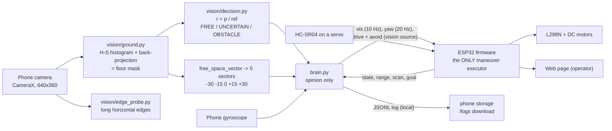

# Architecture

Each frame goes through the same path, on the PC or on the phone. **Decision (path 1): the ESP32 is the only executor of maneuvers.** The phone has no state machine; it sends the vision's *opinion* and the gyroscope heading, and the firmware stops, sweeps, picks an angle and turns.

1. **Segmentation** (`vision/ground.py`). The first frames of a run teach a hue-saturation histogram of the floor. Every later frame is back-projected onto it; the threshold is derived from a low percentile of the region of interest, then cleaned with a median blur and morphology.
2. **Features** (`vision/coverage_log.py`). Per frame: floor fraction and mean floor probability in the lower band (full width and central third), and the fraction of pixels too dark or too bright for hue to be trusted.
3. **Vision state** (`vision/decision.py`). Mean central probability divided by a reference (the median over the first 0.9 s) gives a relative confidence `r`. Thresholds on `r` with hysteresis and persistence in seconds produce `FREE`, `UNCERTAIN` or `OBSTACLE` (`LIVRE`, `INCERTO`, `OBSTÁCULO` in the code).
4. **Free-space sectors** (`vision/ground.free_space_vector` + `free_sectors`). The 40 strips (8 px each at 320 px) are reduced to 5 sectors aligned with the sensor servo (-30, -15, 0, +15, +30°, horizontal FOV ~74°); each value is the 20th percentile of its 8 strips, 0..100. Image left = car left.
5. **Edge probe** (`vision/edge_probe.py`). Automatic Canny keeps only long, nearly horizontal edges (the wall-floor contact line) and reports how far up the image the first one sits.
6. **Brain** (`brain.py`, the only owner of the WebSocket). Reads `vision_state` explicitly, sends `vis` (ok flag + 5 sectors, ~10 Hz) and `yaw` (unbounded heading `psi` and rate, ~20 Hz, from the phone gyroscope). With the *vision* source it also sends `drive` (speed from the vision state, steering from the `HeadingHold`) and, on `OBSTACLE`, `avoid` with the freest sector's angle. It writes a local JSONL log.
7. **Firmware** (`car_firmware/`). The ESP32 runs FRENTE / VARREDURA / DESVIO. "No echo" has three states (valid, free, suspect) decided from the **median**, the history and, in vision mode, the fresh sector 0. A suspect reading or a median below `d_stop_cm` stops the car and sweeps -30, -15, +15, +30°; the best angle wins (ties: smaller |angle|, then left); the turn runs until the yaw delta reaches the angle (or `angle / turn_dps` without yaw). In vision mode it also vetoes the phone at 30 cm and keeps the reflexes (20 cm hard stop, 500 ms watchdog, reverse limit).

*The `control/controller.py` state machine is frozen: it is the v1 reference and is used only by `replay/`, `tools/bench_s9.py` and the tests. The live path (`main.py`, `brain.py`) does not import it, nor the mocks.*

| Layer | Code | Interface |
|---|---|---|
| Perception and decision | `vision/`, `control/`, `config.py` | pure functions and small classes; no I/O |
| Hardware abstraction | `control/hal.py`, `control/mocks.py` | `Drive`, `Reading`, `LinkRangeHead` / `LinkDrive` over serial or memory (`hal.py`); `MockRangeHead` / `MockDriveLink` / `Scenario` for replay and tests only (`mocks.py`) |
| Run loop | `main.py` (`VisionRunner`, `StreamRunner`), `brain.py`; offline: `replay/offline.py` | `feed(frame, t)` returns the vision opinion per frame (`vision_state`, `r`, `sectors`, `edge_*`, `ok`) |
| Phone app | `android/` | CameraX frames to Python through Chaquopy |
| Firmware | `car_firmware/` | JSON, one message per line, same format on serial and WebSocket; soft AP `CARRINHO`, HTTP on 80, WebSocket on 81 |

All tunable values live in one `config.py`, and the ones that still need measuring on the real car are listed in [`docs/parametros_a_calibrar.md`](parametros_a_calibrar.md). The wire protocol is documented in [`docs/protocolo_ws.md`](protocolo_ws.md).

## Operator view

The ESP32 serves a single web page at `http://192.168.4.1` (no app to install) that any phone can open once connected to the car's Wi-Fi. It is how the car is operated and observed while it runs:

- **Motivation** (goal): **Explore: sensor** (the ESP32 drives alone, auto mode) or **Explore: vision** (phone mode: vision + heading, the ESP32 vetoes and maneuvers), and **STOP ALL** (resets everything). The goal and its source are relayed to the brain on the phone and to every client; the ESP32 arms itself 4 s after an *explore* goal.
- **State**: active source, FSM state, distance ahead (and its class: valid / free / suspect), the angle chosen in the last sweep, vision state, uptime and the reason of the last reset (the firmware reports brownouts).
- **Robot's view**: frame, back-projection and mask, streamed as MJPEG by the phone (`viz.py`); the image does not pass through the ESP32. It is low resolution because that is what reaches the pipeline (320 px wide); the visible floor ahead spans about 130 cm (measured).
- **Thought**: the brain publishes short `think` messages (text, state, confidence) that the page shows next to the sensor radar. A log can be recorded and downloaded from the page, and a link opens the phone's local JSONL logs (`/logs`).

(The interface text is in Portuguese.)

## Wiring and drive

Differential drive: two DC motors on an L298N, no steering servo. The ultrasonic sensor sits on its own servo so the car can look left and right.

| Signal | ESP32 pin | Note |
|---|---|---|
| HC-SR04 TRIG / ECHO | 23 / 22 | ECHO is 5 V, so it goes through a 1k/2k divider |
| Sensor servo | 18 | |
| L298N ENA / IN1 / IN2 | 19 / 16 / 17 | PWM on ENA |
| L298N ENB / IN3 / IN4 | 32 / 33 / 21 | PWM on ENB, remove the ENB jumper |
| BOOT button / LED | 0 / 2 | arm and disarm / status |

Motor start-up is staggered (one at a time, never while the servo moves) to avoid brownouts, and the firmware reports the reset reason when it recovers from one.
